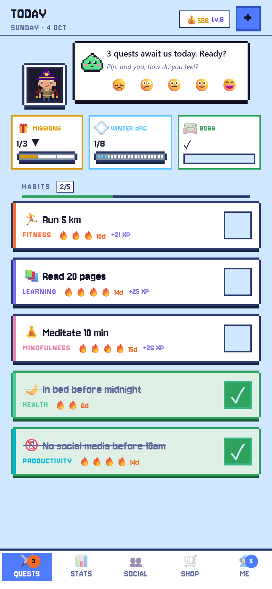
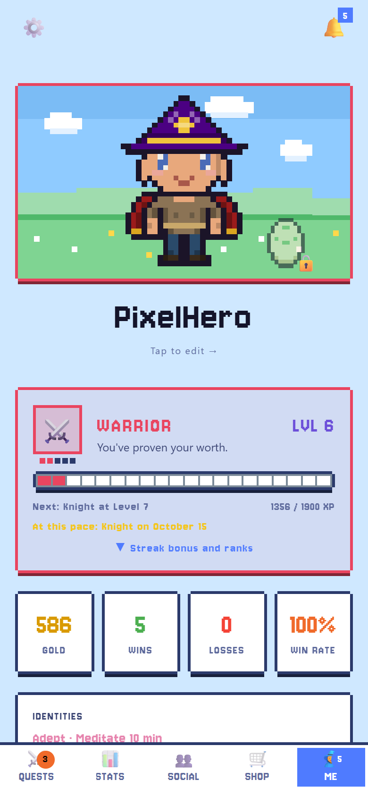
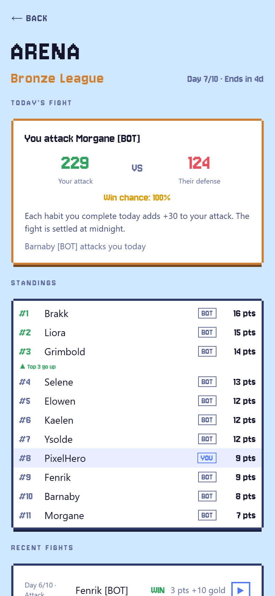
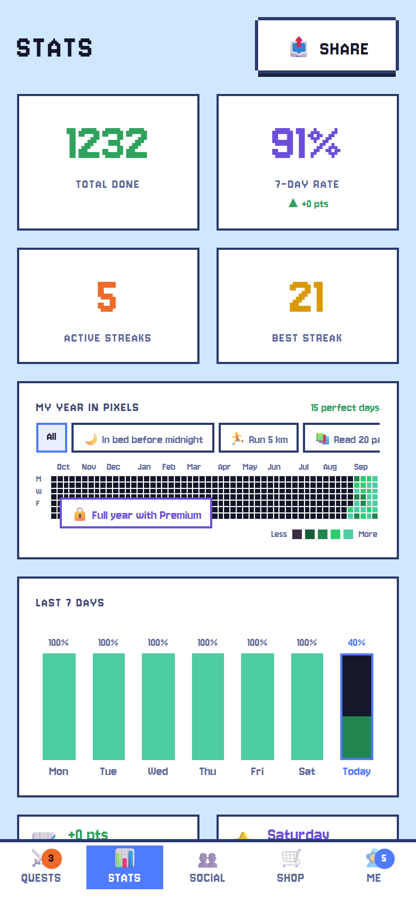

<h1 align="center">HabitQuest</h1>

<b>A habit tracker built like an RPG.</b> Habits become daily quests, bad habits become weekly bosses, and a pixel-art hero levels up with you.

  <a href="https://gethabitquest.com">Website</a> ·
  <a href="https://habitquest.expo.app">Play on the web</a> ·
  iOS (in review) · Android (closed test)

  
  
  
  

## What it is

- **Daily quests**: every habit earns XP and gold; streaks forgive a missed day and a "mini version" counts on hard days.
- **Weekly bosses**: the Snooze Golem, the Doomscroll Kraken, the Couch Troll… every completed quest hits the boss of the week.
- **A hero that grows**: a 32×32 pixel hero with poses and reactions, gear unlocked by the categories of habits you keep, six ranks from Novice to Legend.
- **Social**: friends, turn-based duels, arena leagues and co-op challenges.
- **Habit mastery**: after 21 days in a row, raise your own goal and earn a star.
- Five languages: English, French, Japanese, Korean, Traditional Chinese.

## How it's built

| | |
|---|---|
| App | Expo SDK 55, React Native, expo-router, TypeScript (strict), Legend-State + MMKV for offline-first state, Reanimated |
| Backend | Supabase: Postgres with Row Level Security on every table, RPC functions and triggers, Edge Functions (Deno) |
| Game rules | Server-authoritative: XP, gold, levels, streaks and bosses are computed in Postgres, the client never writes them |
| Payments | RevenueCat (App Store / Google Play subscriptions) |
| Delivery | EAS Build and over-the-air updates, web app on EAS Hosting, CI on GitHub Actions |
| Quality | 650+ Jest / React Native Testing Library tests, 40+ pgTAP database test suites, Monte-Carlo simulation of the game economy |

Some numbers from the private codebase: 80+ database migrations, 33 architecture decision records, 6 Edge Functions.

## About

Designed and built solo by **Battiste Boungo**, from game design and pixel art to backend, payments and store releases.
The source code is private; this repository holds the public website ([gethabitquest.com](https://gethabitquest.com), in `docs/`).

Contact: habitquest.application@gmail.com · [GitHub](https://github.com/battisteb)

© 2026 Battiste Boungo. All rights reserved.
